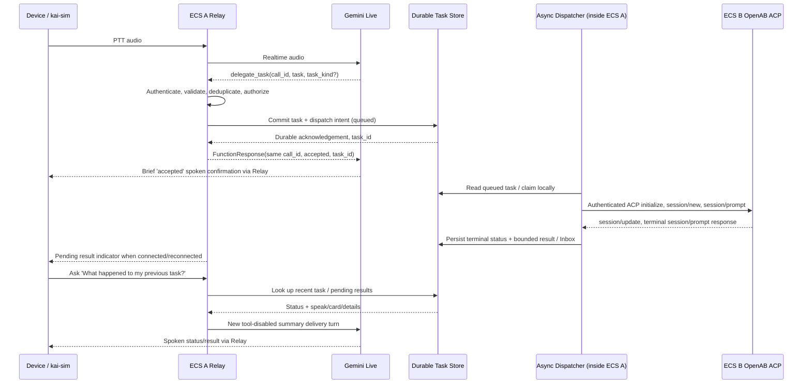

# ADR-0001 — Two-Service Relay + OpenAB ACP Architecture

- **Status:** Accepted architecture amendment (PR #9; supersedes the earlier three-ECS topology; not a deployment approval)
- **Updated:** 2026-10-11
- **Scope:** P3 slow-task implementation and P4 AWS integration
- **Requirements authority:** [SPEC.md](../../SPEC.md)
- **Upstream inspiration:** [Kai architecture](https://github.com/zbruceli/kai/blob/1681fb3c11acd28525d8987bba4b9bf4bc2a288f/docs/ARCHITECTURE.md)
- **OpenAB ACP research baseline:** [openabdev/openab `6431a1b6`](https://github.com/openabdev/openab/tree/6431a1b6991673429f344acb78a58d94658d30fb)

> **Document boundary:** This accepted documentation amendment is not evidence of deployment or production readiness. It retains the accepted ACP delegation direction and historical feasibility evidence while correcting the ECS topology. No credentials, private infrastructure identifiers, or personal agent aliases are part of the specification.

## 1. Context: what Amusant is

Amusant is a **one-to-one, grab-to-talk personal voice companion**, not a multi-tenant SaaS, fleet gateway, or general-purpose agent orchestration platform. Its goal is a low-friction physical push-to-talk (PTT) interaction with fast speech and optional background work.

The intended personal deployment has **one active Relay instance and one configured agent runtime**. `kai-sim` and an eventual hardware frontend can be used as alternative clients during development; that does not create a multi-user or multi-Relay requirement.

The original architecture was based on Kai's two-component design:

1. **Relay:** handles device sessions, Gemini Live, handoff, job tracking, and inbox delivery.
2. **Agent runtime:** performs the computationally slower reasoning and authorized tools.

The previous version of this ADR incorrectly promoted a *logical asynchronous Worker* to a third independently deployed ECS Service. That was an optimization for hypothetical scaling and IAM separation rather than an established product requirement.

## 2. Amended decision — exactly two ECS Services

The AWS baseline consists of **two ECS Services**:

| Deployment | Role | Contains |
|---|---|---|
| **ECS A — Amusant Relay** | Thin voice gateway and task delivery coordinator | Device gateway, Gemini Live adapter, `delegate_task` admission, lightweight Task Ledger, **internal Async Dispatcher**, ACP client, Result Inbox |
| **ECS B — OpenAB Agent Runtime** | Isolated slow agent backend | Authenticated ACP endpoint, configured agent/model, permitted execution tools, agent session/context |

- The Worker/Dispatcher is **Python application logic inside ECS A**, not another ECS task, service, queue consumer deployment, or mandatory sidecar.
- Gemini Live is an external provider, not ECS C.
- A managed datastore, if selected, is not an ECS Service.
- **No standalone Worker ECS, multi-Relay routing, per-user provisioning, or horizontal scaling is required in P3/P4.**
- `desiredCount=1` is the intended steady-state count for the Relay. Deployment overlap is an operational concern: choose a stop-before-start/reconnect strategy if exactly one active Relay is required during updates, accepting brief downtime. Do not design multi-Relay orchestration for the MVP.

### Logical and deployment diagram

```text
                    DEVICE / KAI-SIM
                     PTT, audio, cards
                           |
                  authenticated WSS *
                           |
        +----------------------------------------+
        | ECS A — AMUSANT RELAY                  |
        |                                        |       Google
        |  Device Session <--> Gemini Adapter --+----> Gemini Live
        |                            |           |      (FAST voice,
        |               delegate_task()          |       tool routing)
        |                            v           |
        |  Task Ledger --> Async Dispatcher      |
        |       ^               |                |
        |       |           ACP Client ----------+--------+
        |       |               |                |        |
        |  Result Inbox <-------+                |        |
        +----------|-----------------------------+        |
                   |                                      | private,
         durable read/write                               | authenticated WSS
                   |                                      v
         +-------------------+                  +--------------------------+
         | Small Task Store  |                  | ECS B — OPENAB RUNTIME   |
         | Task + Inbox      |                  | Agent reasoning + tools  |
         +-------------------+                  | Agent session/context    |
                                                +--------------------------+
```

`*` Device transport must be validated against Kai's actual protocol. Upstream TLS-PSK is not automatically compatible with ALB TLS termination; the final supported ingress must be proven before public access.

**The two ECS Services are separate trust boundaries.** The Relay-internal Worker shares the Relay task's IAM role and process lifecycle by design. The OpenAB runtime uses its own independent ECS task permissions and agent credentials.

## 3. Why an independent Worker ECS is not needed

The Relay-side Worker is not a second agent or reasoning engine. Its work is primarily asynchronous network I/O:

1. Find admitted queued jobs.
2. Send bounded task text over ACP to OpenAB.
3. Await a terminal result without blocking voice interactions.
4. Update task status and the Inbox.
5. Recover eligible work after a Relay restart.

These operations can run as application-scoped `asyncio` tasks in ECS A, not tied to one device WebSocket. All synchronous storage/network operations must avoid blocking the realtime event loop.

An extra Worker ECS would impose a separate deployment, permissions, health checks, networking, coordination, and costs. None is justified by a **single-owner, single-Relay** baseline. Independent Worker scaling may be reconsidered only after measured resource contention, availability, or mandatory isolation requirements emerge; it is **not part of the current scope**.

## 4. Reference implementation: Kai

Verified Kai source paths at its pinned baseline:

- [Kai background-brain architecture](https://github.com/zbruceli/kai/blob/1681fb3c11acd28525d8987bba4b9bf4bc2a288f/docs/ARCHITECTURE.md#L97-L123)
- [Relay `server.py`](https://github.com/zbruceli/kai/blob/1681fb3c11acd28525d8987bba4b9bf4bc2a288f/relay/kai_relay/server.py)
- [Relay `agent.py` / `AgentHub`](https://github.com/zbruceli/kai/blob/1681fb3c11acd28525d8987bba4b9bf4bc2a288f/relay/kai_relay/agent.py)
- [Hermes API adapter](https://github.com/zbruceli/kai/blob/1681fb3c11acd28525d8987bba4b9bf4bc2a288f/relay/kai_relay/hermes.py)

Kai puts task coordination, asynchronous task following, SQLite task state, and Inbox *inside the Relay process*. Hermes runs separately in Docker as the slow Agent. No standalone third Worker Service exists. Kai runs both backend components on a single host; Amusant uses separate ECS Services for isolation.

| Kai | Amusant | Design difference |
|---|---|---|
| Kai Relay / `AgentHub` | ECS A Relay / Task Ledger + Dispatcher | AWS task filesystem is ephemeral; persisted state must survive task replacement |
| `ask_agent` | `delegate_task` | Admission must be durable before spoken acknowledgement |
| `HermesClient` / HTTP `/v1/runs` | ACP client / WebSocket `session/prompt` | ACP does not offer equivalent durable job status retrieval |
| Hermes Docker | ECS B OpenAB | Agent tools and credentials isolated from Relay |
| SQLite `tasks` + `inbox` | Task Ledger + Result Inbox | Store only lightweight work receipts and bounded final delivery snapshots |

**Important:** Kai saves a Hermes `run_id`, later polls `/v1/runs/{id}`, and resumes tracking that run after Relay restart. OpenAB's ACP `session/resume` instead resumes *conversation context*, without replaying prior result messages or exposing a durable run-result query. These are **not equivalent**. Do not represent an ACP `sessionId` as a persistent job ID.

## 5. Ownership: three different forms of state

| State | Owner | Persistence requirement |
|---|---|---|
| **Voice session** | Gemini Live + Relay | Ephemeral; normal device/Live reconnect may start a fresh session |
| **Task Ledger / Result Inbox** | Amusant Relay (stored outside volatile process memory) | Must survive Live/device disconnect and ECS A replacement |
| **Agent context/session** | OpenAB / downstream agent | Managed by backend policy and session retention; `session/resume` is best-effort context continuity, **not** work completion tracking |

Amusant must be able to answer **“What happened to the research I asked for yesterday?”** by querying its Task Ledger/Inbox in a **new Gemini Live session**. It must not depend on Gemini remembering a previous session, nor require rerunning a completed agent job.

The Relay does **not** implement a user-memory system, vector database, chat archive, multi-agent orchestration, or agent tool log repository.

## 6. Minimal Task Ledger and Result Inbox

### Persist only task receipts and deliverable results

Suggested minimal record:

```json
{
  "task_id": "t_illustrative",
  "conversation_id": "c_illustrative",
  "turn_id": 7,
  "call_id": "call_illustrative",
  "task_kind": "research",
  "task_text": "Compare three laptops for local AI workloads",
  "status": "completed",
  "created_at": "2026-10-10T08:00:00Z",
  "updated_at": "2026-10-10T08:01:14Z",
  "attempts": 1,
  "result": {
    "speak": "The second option is a better value for local AI.",
    "card": {"title": "Laptop comparison", "lines": ["Option B recommended"]},
    "details_md": "Concise final comparison ..."
  },
  "delivery_state": "pending"
}
```

Required fields/semantics: trusted owner/client scope, durable task ID, dedupe identity `(client_id, conversation_id, turn_id, call_id)`, task text and allowed kind, configured backend identifier, timestamps/expiry, status, bounded attempt/dispatch stage, a bounded final result, and separate delivery state. `sessionId` may be tracked diagnostically but is **not** a durable work handle.

**Do not persist:** raw PCM, full Gemini transcripts by default, model chain-of-thought, agent internal history, intermediate web pages, shell/browser traces, secrets, or provider credentials.

Result format: normalized `speak` (brief spoken summary), small `card`, bounded `details_md`. Treat backend text as untrusted and sanitize before speech/display. For the initial design, a configurable **30-day default retention** for final task receipts/results is proposed, not yet a production policy. Bound both text size and pending-task count; do not store arbitrarily large reports in the Task Ledger.

Task completion and result *delivery* are different: a completed result may remain pending while the device is offline. A new voice session can query status/Inbox, and tool-disabled speech can read the saved summary upon user request.

### Store choice and lifecycle

- **P3 local/offline:** Retain PR #8's SQLite durable admission and same-transaction outbox. SQLite remains useful for tests; extend it with completion/results in later implementation slices.
- **AWS:** An external durable store is required before claiming survival of ECS A replacement. **DynamoDB is the preferred small-store option, subject to separate cost/security/implementation approval**, not an already-provisioned requirement. A container-local SQLite file does not meet AWS restart durability.
- **SQS:** Not required in the two-Service MVP. The internal Dispatcher may wake immediately on admission and independently recover `queued` records on startup/periodically. If SQS is added in a later design, explicitly preserve atomic dispatch-intent semantics; do not blindly dual-write.
- The record store belongs to the Relay's *logical responsibility*, even when the bytes live in an AWS managed service. It should remain small and outside the voice critical path.

## 7. Slow-task sequence and honest acknowledgement



`delegate_task(task: string, task_kind?: 'research' | 'compare' | 'summarize')` is backend-neutral. Model arguments cannot select backend URLs, tools, arbitrary agents, files, commands, or credentials. The server supplies identity, task ID, backend, authorization, and deadlines.

The original Gemini tool call receives **one** response with the same provider call ID, confirming durable *admission only*. A completed background task becomes an Inbox event, **not** a second FunctionResponse. Ensure the selected Live model/SDK's calling behavior supports the intended short admission acknowledgement; verify rather than assume a model-specific default. Do not wait for the ACP task to finish inside the Live callback.

A new Live session must have a bounded, authorized way to query recent Task Ledger/Inbox entries (for example `check_task_status`/`check_inbox` as Relay-local tools); the implementation must not rely on previous model context.

## 8. ACP execution contract

OpenAB's pinned source provides authenticated **`GET /acp` WebSocket, JSON-RPC 2.0**:

1. `initialize` with ACP protocol version `1`.
2. `session/new` with server-controlled `cwd` and `mcpServers: []`; capture `sessionId`.
3. `session/prompt` using only bounded approved text; collect correlated `session/update` text.
4. Treat the matching terminal `session/prompt` `stopReason: end_turn` as successful completion; handle cancelled, JSON-RPC error, timeout and disconnect as distinct failures/uncertain outcomes.
5. Normalize agent output to a bounded `speak`, `card`, and `details_md` result.

The runtime must actually include the ACP compile feature, enable its endpoint, authenticate the WebSocket bearer token, and authorize the synthetic ACP sender. Source-level support is not proof of correct deployed configuration. Keep only a controlled private ACP endpoint; protect cross-task transport with validated TLS/WSS and Security Group rules.

Research baseline limitations: OpenAB's ACP base uses a **180-second prompt idle timeout** and does not yet reliably cancel the underlying agent work. The initial bounded task attempt is **120 seconds**. An agent that exceeds it may continue executing even after the client disconnects. Arbitrarily long unattended background jobs require a separate future capability; do not promise they are supported in this MVP.

Sources:

- [OpenAB ACP as-built ADR](https://github.com/openabdev/openab/blob/6431a1b6991673429f344acb78a58d94658d30fb/docs/adr/acp-server-websocket-base.md)
- [ACP server implementation](https://github.com/openabdev/openab/blob/6431a1b6991673429f344acb78a58d94658d30fb/crates/openab-gateway/src/adapters/acp_server.rs)

## 9. Restart recovery, without distributed-systems overdesign

Only one active Relay is in scope. Do **not** introduce multi-Relay leader election, horizontally scaled Worker services, distributed work-stealing, or SQS as an assumed dependency.

Still handle these real single-Relay failure windows:

| Incident | Required behavior |
|---|---|
| Accepted `queued` task; Relay exits **before ACP dispatch** | Durable record survives; new Relay sees and dispatches it on startup |
| Relay exits **after sending ACP prompt but before terminal result is stored** | Mark state **`uncertain`** (or equivalent explicitly ambiguous stage); do not claim the work completed or was cancelled |
| Agent returns a successful terminal result | Persist `completed` and Inbox result; do not create duplicate Inbox records on retry |
| Device or Gemini Live disconnects | Continue processing eligible task; result remains queryable after reconnection |
| Backend/network error or timeout | Bounded retry only for explicitly safe, read-only tasks; otherwise report `failed`/`expired`/`uncertain` honestly |

Recommended states: `queued → running → completed | failed | expired | uncertain`, with `retrying` if needed. Track whether ACP dispatch **may already have happened** before permitting automatic retry. Persistence cannot make remote ACP execution exactly once; an interrupted prompt may be duplicated and cause additional model cost.

For a single Relay, a lightweight recovery scan and per-task execution stage are enough. Additional lease/claim fencing for simultaneous workers is **not an MVP gate**. Any future change that creates multiple active Relay processes must separately assess storage-level claims and duplicate-result fencing.

**Important:** `session/resume` is not a durable job tracker. Only agent-side durable run/status APIs could close that gap as Kai's Hermes does. Do not build such an API in P3 solely to imitate Hermes; document the limitation and prefer bounded, read-only slow jobs.

## 10. Security and privacy boundary

- **ECS A** authenticates the device, validates Live tool calls, stores minimal task receipts and bounded delivery snapshots, and accesses only necessary provider/ACP credentials and task-storage permissions.
- **ECS B** executes agent tasks with independently controlled tool permissions, filesystem, egress, model credentials, and no task-store write access. No access to private personal gateways or unrelated secrets is authorized.
- Do not expose ACP publicly. Permit only authorized Relay-to-Agent traffic with mutually appropriate network policy and bearer credentials; private networking is **not** a substitute for transport encryption.
- Raw voice audio, full transcripts, agent scratchpads, chain-of-thought, unbounded browsing traces, and secrets **must not** be written to the Task Ledger.
- Never accept model-selected executable commands/tool lists/backend endpoints. Disallow side-effecting actions and unauthorized broad tools during the initial slow-path scope; enforce at the runtime/tool boundary, not just with prompts.
- Agent output is untrusted. Inject an Inbox `speak` value into a new **tool-disabled** voice turn for spoken delivery.
- Make data retention configurable and protect stored task text/results as potentially sensitive.
- Respect external provider costs, per-attempt timeouts, retries and user-facing failure states.

**Feasibility evidence versus deployment authorization:** Prior P3.0 ACP and one-off client-to-Agent experiments established protocol/model connectivity under a narrowly scoped test risk acceptance. They did **not** establish locked-down agent capabilities, durable production Relay/Inbox, or approval for new AWS resources and paid model tests.

## 11. Staging and milestone impact

- **P0/P1/P2:** Already completed under earlier validated gates; unchanged by this amendment.
- **P3.0:** ACP connectivity/model feasibility previously verified in isolated, one-off tests; do not interpret as production readiness.
- **P3.1:** Existing SQLite `delegate_task` admission and atomic outbox implementation merged. Local CLI now wires the tool declaration and admission handler; ECS/service startup and a replacement-safe store remain.
- **P3.2:** Application-scoped Async Dispatcher, SQLite lifecycle migration, queued recovery, and fake-executor offline tests. Real ACP remains P3.3; cloud persistence is separately approved.
- **P3.3:** Relay ACP client for read-only bounded tasks, terminal-result parsing, errors, and uncertain execution. Implemented offline against a fake `/acp` server; live ECS B/Jellii remains separately gated.
- **P3.4:** Persistent Inbox and voice-session-independent task-status/result lookup. Implemented offline as `check_task_status` on SQLite with independent delivery_state. User-requested speech returns the saved `speak` field and marks `spoken`; a new Gemini tool-disabled Live turn remains unproven. Live ECS stays separately gated.
- **P4-A1 code:** ACP `cwd` is a remote runtime path. `wss://` must verify TLS; plaintext `ws://` is an explicit private-network exception, not a certificate bypass.
- **P4-A1 live one-off:** Recorded PASS 2026-10-12 against Jellii using same-SG plaintext `/acp`. Cleanup returned Jellii to desiredCount 0. This does not approve TLS, an external Task Store, 24/7 Relay, or device ingress.
- **P4:** Approve and validate two-ECS staging/production networking, external durable storage, security, deploy/restart behavior, audio latency, cost and operational metrics.
- **H0/H1:** Dedicated hardware remains gated on demonstrably improved interaction friction.

P3 local mocks remain valid development tools. AWS integration is the **target topology**, but no additional deployment, change to live permissions, or paid calls are authorized by this documentation revision.

## 12. Superseded and deferred assumptions

Superseded by this amendment:

- A standalone **Worker ECS Service** and third Worker IAM boundary.
- Mandatory **SQS** for low-volume personal task dispatch.
- Multi-Relay/multi-tenant support as a design gate.
- Treating task-history storage as an agent memory system.
- Assuming ACP `session/resume` can retrieve the result of a disconnected in-flight prompt.

Deferred:

- Horizontally scaled Relay and Worker deployments.
- Side-effecting autonomous actions; broad file/shell/browser tool permission without separate authorization.
- Backend durable job API, exactly-once execution, true downstream cancellation, and unattended jobs beyond the bounded ACP attempt.
- Proactive monitoring, recurring schedules, multi-agent switching, broad memory management, multiple owners and fleet administration.

## 13. Documentation-only acceptance criteria

PR #9 adopts this amendment as a **documentation-only architecture decision**. The review confirmed the following: exactly two ECS Services (Relay + OpenAB); the Async Dispatcher stays inside Relay; Gemini Live remains the realtime router; Task Ledger/Inbox and restart uncertainty remain Relay-owned; voice-session, task-history, and agent-context ownership stay distinct; P3.0/P3.1 evidence is preserved and pending implementation is not marked complete. The SPEC/ADR contain no credentials, personal agent aliases, private endpoints, or account identifiers. No application code, AWS resources, permissions, or paid model calls were changed.

**Principle:** The Relay is a thin voice gateway with a lightweight task ledger and result inbox. OpenAB owns agent reasoning and context. Logical asynchronous work does not justify a third deployment service.
