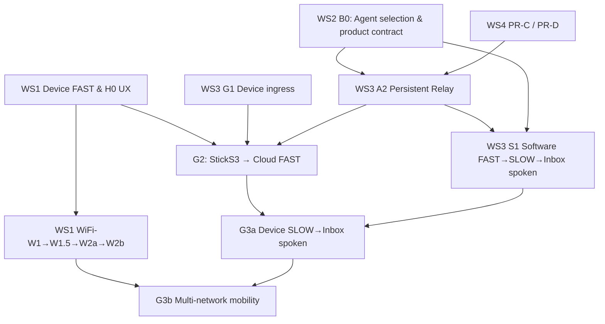

# Amusant Project Execution — Four Workstreams (WS1–WS4)

> Owner-approved PM restructuring: 2026-10-16. **Planning and tracking only; no runtime changes or execution authorization.**
> This document is the **active workstream index**. `SPEC.md` remains normative; ADRs record accepted architecture; `PLAN.md` is the execution sequence; `STATUS.md` contains evidence; older P0–P4/H0/H1 and the [cross-track roadmap](hardware/cross-track-integration-roadmap.md) remain historical Gate identifiers.
> Naming: **WS1–WS4 = program workstreams**; **WiFi-W1 / W1.5 / W2a / W2b = firmware provisioning slices**, never interchangeable.

## North star and scoped releases

- **M1 — Cloud Voice-Agent Alpha:** a reliable Relay, real Fast answer, durable Slow admission/execution, owner-authorized next-session Inbox retrieval and **tool-disabled spoken result**, meaningful failure/recovery, monitored cost and rollback. A software-client E2E (S1) precedes physical-device G3a; one known 2.4 GHz SSID is adequate for G2.
- **M2 — Personal Companion Beta:** practical mobility/provisioning, safe/unobtrusive task completion notice, opt-in notes/reminders/memory with defined retention, power/latency and operational UX. These features do **not** block M1.
- Do not infer one-to-one means zero concurrency: simultaneous Fast conversations and queued Slow work must be explicitly product-defined. Current single in-process Dispatcher, default pending cap 8 and OpenAB ACP 120-second attempt limit remain the *implemented baseline*, not a promise of multi-hour tasks.
- **Product contract before B0**: expected Slow task length, progress/query/cancel semantics, concurrent Fast/Slow behavior, active/sleeping completion notification, result delivery vs audio actually heard, ownership/privacy/retention and error language. Propose changes to SPEC/ADR for approval; this PM restructure does **not** amend the accepted OpenAB/two-ECS baseline.

## Work Breakdown Structure

| Workstream | Scope and current evidence | Immediate work | Tracking |
|---|---|---|---|
| **WS1 — Edge Device & Fast UX** | Real StickS3 → local Amusant Relay → Gemini audible FAST 10/10 PASS; #33 six avatar states and physical PTT regression PASS. Formal latency UX still pending. | Stage D #42 persona/Zephyr/Google Search live test; choose only needed Kai-parity capabilities; H0 latency/power; firmware ownership and WiFi-W1 → W1.5 BLE decision → W2a → W2b (BLE or SoftAP, not both required). | #31 #33 #14 #11 #36 #43; PR #42 |
| **WS2 — Agent Backend & Slow Product** | Accepted OpenAB ACP cloud one-off PASS (#26); Hermes native Runs local Docker Phase 2A/2B fake-provider POC PASS, **no live/cloud acceptance**. | **B0** time-boxed agent/hosting selection using task quality, duration, recovery, tool sandbox, isolation, hosting costs and operational complexity. OpenAB remains accepted until an explicit ADR/SPEC change; preserve backend-neutral Relay. | #44 PR #45; #43 companion behavior |
| **WS3 — Placement, Transport & E2E** | Local physical FAST and cloud one-off ACP/DynamoDB independently PASS; persistent Service A and public device ingress **not** verified. | #27 G1: safe device-to-Relay edge transport/ingress (Cloudflare standard WSS or PSK-compatible TCP; route/ownership audit); #35 A2 persistent Relay; **#46 S1** software cloud Fast→Slow→Inbox spoken; G2 single known Wi-Fi device→cloud FAST; G3a physical Slow E2E; G3b mobility joins Wi-Fi provisioning. | #27 #35 #46 #26 #31 #36 |
| **WS4 — Robustness, Security & Operations** | Offline CI #34 and Inbox protection #40, Dispatcher wake #41 merged; T4b bounded TLS/ledger proof with procedural exceptions. | **PR-C** >100/500 TASK historical rows, dedup/latest/recovery; **PR-D** bounded shutdown, Python 3.13, non-smoke persistent entrypoint, health/non-root; secret/tool/egress, no replay after ambiguous send, monitoring, cost and retention/delete before unattended service. | #30 #35; PR #39 review brief |

## Decision and gate register

| ID | Nature | Entry / exit criterion | Dependents |
|---|---|---|---|
| **H0/G0** | Functional PASS, UX not fully accepted | #31 10/10 real-device local FAST; finalize p50/p95 **actual audible onset**, wake/reconnect and battery evidence/owner Go/No-Go; #33 avatar + audio PASS, power regression separate. | WiFi H1 firmware go/no-go |
| **B0** | **Architecture decision, OPEN** | Compare OpenAB ACP and Hermes native Runs with representative long/research tasks, real tool quality, lifecycle/retention, least privilege, hosting **ECS vs VM vs isolated N100** and costs; time-box research. Formal signoff + SPEC/ADR if changing. | Agent production deployment and S1 final backend |
| **PR-C** | **Hard A2 live gate** | >100 and 500+ completed history cannot block admission, pending capacity, dispatch, latest Inbox, dedup; bounded query/read costs (DynamoDB TTL alone insufficient). | Persistent A2 live |
| **PR-D** | **Hard A2 live gate** | Bounded graceful shutdown with uncertain post-send behavior, restart recovery; Python 3.13/TLS-PSK capability; real persistent entrypoint, ECS health, non-root. | Persistent A2 live |
| **A2** | **Service runtime, OPEN** | Read-only/offline implementation can proceed before B0; live canary after PR-C/D, backend choice and separately approved resources: Service A 1 healthy, restart/rollback/DynamoDB. If B0 changes hosting/topology, revise ADR and #35 first. | S1 / G2 |
| **G1** | **Device-edge decision and proof, OPEN** | Offline fake client authentication/TLS/reconnect/fail-closed, then separately authorized ingress canary. Native Kai TLS-PSK is not Cloudflare HTTPS WSS; existing stopped shared Gateway sidecar is not confirmed reusable. | G2 |
| **S1** | **Software cloud E2E, OPEN** | #46: Live tool admission → Agent → persisted Inbox → *new* tool-free voice session speaks result; restart/unknown status/delivery-state safety; no physical hardware prerequisite. | G3a |
| **G2** | **Physical cloud FAST, OPEN** | A2+G1; real StickS3 on **one already-known Wi-Fi** → AWS Relay → audible Gemini FAST, authenticated transport, reconnect/latency. No provisioning prerequisite. | G3a |
| **G3a** | **Physical full Slow E2E, OPEN** | S1+G2; owner-operated device delegates Slow, next PTT retrieves spoken result, correct UI, recovery and failure semantics. | M1 physical acceptance |
| **WiFi-W1/W1.5/W2a/W2b** | **Parallel H1 feature track** | NVS USB single profile → secure official Android BLE feasibility with per-device PoP → up to ~5 profiles → **one selected** BLE-app or secure time-limited SoftAP/portal. Freeze tested local Relay; separately approve flash. | G3b (not G2/G3a) |
| **G3b** | **Companion mobility, OPEN** | G3a + accepted provisioning: network switch/hotspot + cloud FAST/SLOW and battery/performance regressions. | M2 |

## Work graph — independent streams, explicit join

## Execution waves (dependencies, not invented calendar dates)

1. **Wave 0 — PM hygiene:** reconcile STATUS/PLAN; freeze the S1/G3a/G3b definitions; map issues/PRs; distinguish implemented vs live-proven. #26 one-off accepted evidence remains, no re-run. #33 avatar/physical PTT completed; power testing tracked at #14. Open PR #39 is a docs plan whose A/B slices were already delivered by #40/#41.
2. **Wave 1 — parallel:** WS2 B0 product contract and backend/hosting bake-off; WS4 PR-C then PR-D as small reviewed PRs; WS3 G1 read-only/offline transport and #35 A2.0/A2.1 (do not prematurely hardwire agent); WS1 #42 Stage D and H0 UX/latency. WiFi-W1/W1.5 may start after H0 firmware go/no-go, with local Relay frozen.
3. **Wave 2 — service and software E2E:** owner-approved A2.2 cloud canary **after** hard gates and B0; #46 S1 with software client and selected backend; device edge G1 live proof separately.
4. **Wave 3 — physical join:** G2 single-Wi-Fi cloud FAST; G3a real StickS3 Slow→durable Inbox→next-session spoken result.
5. **Wave 4 — companion mobility:** WiFi-W2a/W2b, G3b; then notes, reminders, proactive unread cues and opt-in memory under separately reviewed product/security contracts.

## Evidence / issue hygiene

- **E1:** merged code + offline regression CI. **E2:** actual local runtime/physical test. **E3:** bounded live cloud or cross-system test. **E4:** sustained service/restart/security/cost/operations accepted. Evidence level attaches to a *specific test boundary*, not a blanket project status.
- Each gate should capture versions: firmware source/bin, Relay SHA/image digest, backend revision, TLS mode, Wi-Fi scenario, test scope, sanitized event IDs, count and latency method, approval envelope, rollback, failures and exceptions.
- Issue lifecycle: `Backlog → Ready → Doing → Blocked → Verification → Done`; `Open/Closed` alone is not proof. Suggested owner-review cadence: weekly WIP limit **one active build per WS1–WS3 and one WS4 remediation**; Agent selection is time-boxed spike, not an indefinite extra build stream.
- **Scope hygiene:** #43 is a menu, not a Kai parity mandate. Prioritize search/voice, idle Live session cost watchdog, safe Inbox completion/unread cue. Weather/parking/sun/tides/default location/multi-device are deferred unless owner reverses decision. Notes/reminders/memory require explicit retention/authorization, not simply voice tool parity.
- PR #42 and #45 remain Draft until separately accepted; a green CI is not a real-device/real-Agent gate. Do not merge a backend-switch spike based solely on mock tests.
- All AWS/Cloudflare mutations, real model calls, 24/7 service, real-device firmware flashing/eFuses, secret or public ingress changes need **separate explicit Owner approval**; this workstream reclassification grants none.
